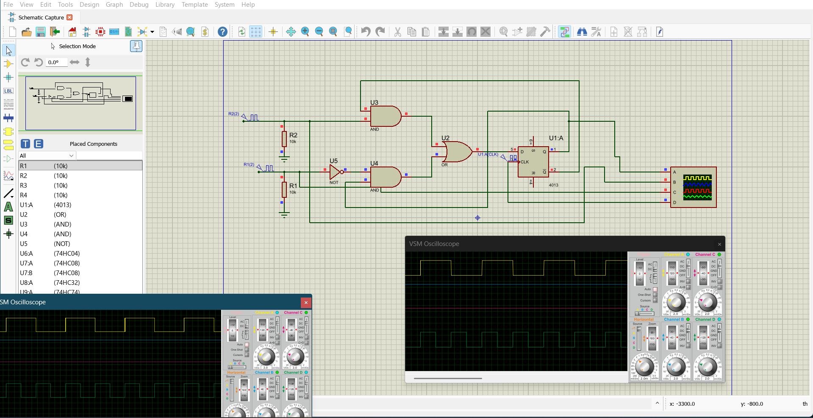

# Synchronous JK Flip-Flop Logic Synthesis & 74HC CMOS Characterization

[](https://scidelo-andriasahy.github.io/?project=8)
[](https://standards.ieee.org/ieee/1076/6769/)

> **Author:** Tsikomia Scidelo ANDRIASAHY — GSEA Engineering (ENSA Tangier)  
> **Live Project Showcase:** [https://scidelo-andriasahy.github.io/?project=8](https://scidelo-andriasahy.github.io/?project=8)



## Overview
Complete synthesis and electrical characterization of a synchronous **JK Flip-Flop** built from discrete **74HC CMOS** gates (`74HC74`, `74HC08`, `74HC32`):
- **Moore FSM Synthesis:** Derived next-state equation `D = J·Q' + K'·Q`.
- **Timing & Electrical Analysis:** Verified noise margins, propagation delays, estimated maximum clock frequency **`f_max = 10.5 MHz`**, and calculated dynamic power dissipation (**`16 mW`** at `10 MHz`).
- **VHDL Model:** Clean synthesizable structural/behavioral VHDL description included in `vhdl/jk_flipflop_moore.vhd`.

## Repository Structure
```text
├── vhdl/          # Synthesizable VHDL implementation (jk_flipflop_moore.vhd)
└── media/         # Discrete 74HC CMOS schematic and real-timing simulation chronograms
```
